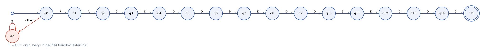
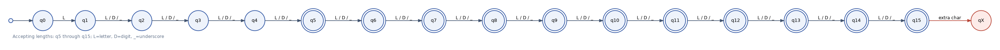
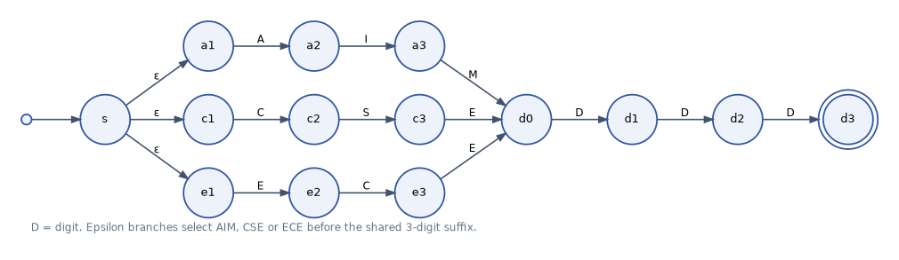
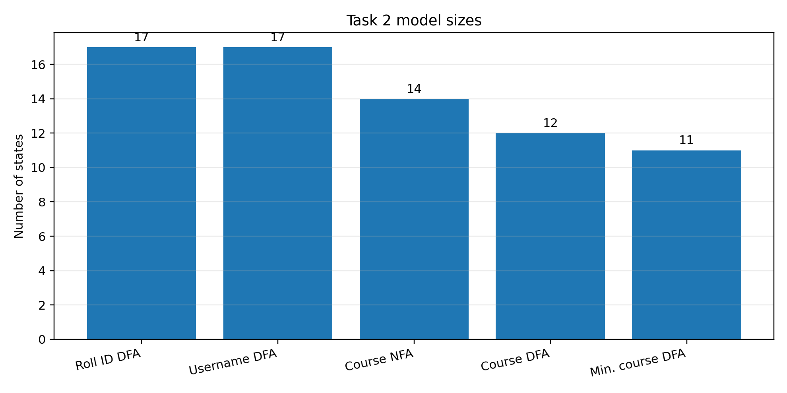

# Task 2 - Finite Automata for Real-Time Input Validation

**Student:** A. Jagan Karthick (RA2411026050020)  
**Course:** 21CSC301T - Formal Language and Automata

## 1. Scope and design choice

The task is to model three input checks as regular languages and execute the corresponding machines on real strings. This implementation uses a registration identifier, a username rule and a course-code rule. Each validator is concerned with the shape of the input. Enrolment status, username availability and whether a course is offered are semantic checks that require data outside the string.

## 2. Student roll identifier

The accepted format is the uppercase prefix `RA` followed by thirteen ASCII decimal digits.

\[
L_{roll}=\{\texttt{RA}x\mid x\in\{0,1,\ldots,9\}^{13}\}.
\]

The input alphabet is grouped into `R`, `A`, `D` (an ASCII digit) and `OTHER`. The DFA moves from `q0` to `q1` only on `R`, then to `q2` on `A`. The remaining thirteen transitions consume one digit each, ending in `q15`. Only `q15` is accepting. Every missing transition leads to the non-accepting trap state `qX`, which loops on all symbol classes.

The current student identifier `RA2411026050020` is a positive test sample for the format. The machine does not verify that this identifier is registered in an institute database.

*Figure 1. DFA for the fixed `RA` plus thirteen-digit format.*

## 3. Username policy

The policy is: 5 to 15 characters; the first character must be an English letter; later characters may be English letters, digits or underscores. A hyphen, whitespace or punctuation is not allowed.

\[
L_{user}=\{w\mid 5\le |w|\le 15,\ w_1\in L,\ w_i\in L\cup D\cup\{\_\}\ (i>1)\}.
\]

`q0` requires a letter and enters `q1`. The state index then records the number of characters consumed. States `q5` through `q15` are accepting. A character outside the permitted classes or a sixteenth character enters `qX`.

*Figure 2. Length-counting DFA; the double circles correspond to permitted lengths.*

## 4. Course-code rule: NFA and subset construction

The accepted code is one of three department prefixes followed by a three-digit number:

\[
L_{code}=\{\texttt{AIM},\texttt{CSE},\texttt{ECE}\}\{0,\ldots,9\}^{3}.
\]

The NFA begins with epsilon transitions to three prefix paths. Each branch consumes its own three letters and then joins a shared three-digit suffix. The accepting state is reached only after the third digit. `OTHER` symbols have no path to acceptance.

*Figure 3. Epsilon-NFA for the three allowed prefixes and a shared digit suffix.*

The subset construction takes the epsilon closure of the start state and creates one DFA state for each reachable subset. The initial machine has 14 NFA states; the generated subset DFA has 12 reachable subset states, including the empty subset. Partition refinement reduces it to 11 states. The three machines are tested for language agreement.

*Figure 4. State counts are generated from the implemented machines.*

| Model | States | Interpretation |
|---|---:|---|
| Roll identifier DFA | 17 | 16 progress states plus trap |
| Username DFA | 17 | 16 length states plus trap |
| Course-code NFA | 14 | Three epsilon branches and common suffix |
| Course-code subset DFA | 12 | Reachable subsets, including empty subset |
| Course-code minimised DFA | 11 | Equivalent DFA states merged |

## 5. Sample validation

| Application | Accepted examples | Rejected examples |
|---|---|---|
| Roll identifier | `RA2411026050020`, `RA1234567890123`, `RA0000000000000`, `RA9999999999999`, `RA0123456789012` | `RA241102605002`, `ra2411026050020`, `RA24110260500200`, `RA24110260A020`, `RB2411026050020` |
| Username | `Jagan_24`, `alpha9`, `student_name`, `XyZ_12345`, `A_bcd`, `a1234` | `2jagan`, `abcd`, `this_username_is_long`, `name-tag`, `name space`, `_name1` |
| Course code | `AIM305`, `CSE201`, `ECE110`, `AIM000`, `ECE999` | `AIM30`, `AIM3000`, `aim305`, `AIM3X5`, `EEE202`, `CSE20A` |

The automated tests compare the course-code NFA, subset DFA and minimised DFA. They also compare the course-code DFA against a separate regular-expression specification for all 1,111,111 strings of length zero through six over a ten-character test alphabet.

## 6. What finite automata can and cannot decide here

A DFA is suitable when the decision depends on a finite amount of information: the current position in a fixed template, a bounded length counter, or membership in a finite set of character classes. It makes a single left-to-right pass and stores only its current state.

The models do not determine facts external to the string. A roll identifier can be well formed but absent from the student registry. A syntactically valid username may already be taken. A course code may follow the format but not exist in the current semester catalogue. Such checks belong to application logic and a data store. Rules requiring unbounded matching or counting would require a stronger formal model and are not covered by these DFAs.
