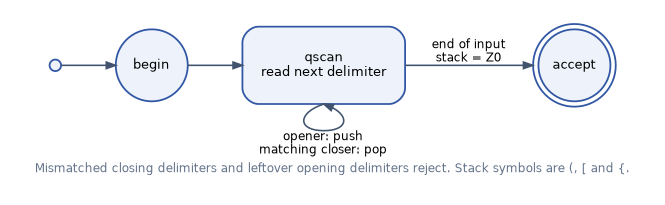
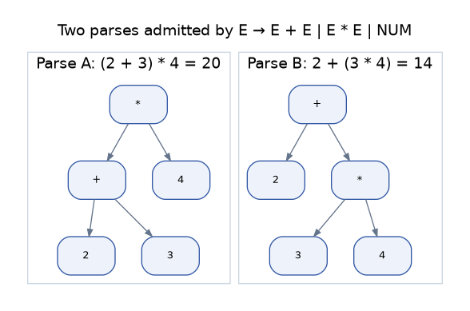
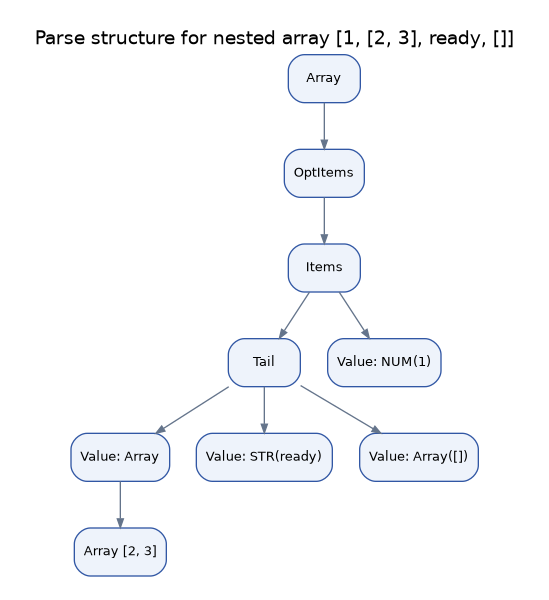
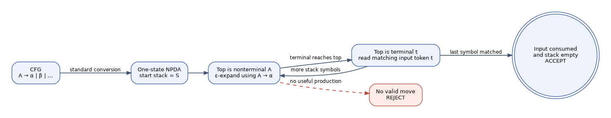

# Task 3 - Case Studies with Context-Free Grammars and Pushdown Automata

**Student:** A. Jagan Karthick (RA2411026050020)  
**Course:** 21CSC301T - Formal Language and Automata

## 1. Why a stack is useful

A finite automaton has only a fixed number of states. It cannot remember an arbitrary number of opening delimiters and then match the same number of closing delimiters in reverse order. A pushdown automaton extends finite control with a last-in-first-out stack. This is the required memory for nesting and recursive syntax.

For the one-type language \(L=\{(^{n})^{n}\mid n\ge 0\}\), suppose a pumping length is \(p\). In the string \((^{p})^{p}\), any split \(xyz\) with \(|xy|\le p\) and \(|y|>0\) places the pumped part entirely among the opening brackets. Pumping it changes the number of open brackets without changing the closing half, so the result is not balanced. The language is not regular.

## 2. Case study A - Delimiter validation

### Language and grammar

The input tokens are `(`, `)`, `[`, `]`, `{` and `}`. A small lexical pass ignores bracket characters inside single- or double-quoted strings. The grammar is:

\[
S\rightarrow (S)S\mid [S]S\mid \{S\}S\mid\epsilon.
\]

The grammar supports empty content, nested groups and concatenation of balanced groups. It generates strings such as `()[]`, `{[()]}` and `([{}])`.

### Deterministic pushdown model

The DPDA begins with the bottom marker `Z0`. When it reads `(`, `[` or `{`, it pushes that opening symbol. When it reads a closing delimiter, it compares the symbol with the stack top; it pops only if the pair matches. An unmatched closer or mismatched pair rejects immediately. After the input ends, the machine accepts only when `Z0` is again the stack top.



*Figure 5. Control-state view of the stack operations used by the delimiter checker.*

### Stack trace

For input `({[]})`, the stack evolves as follows (top at the right):

| Read symbol | Operation | Stack |
|---|---|---|
| Start | initialise | `Z0` |
| `(` | push `(` | `Z0 (` |
| `{` | push `{` | `Z0 ({` |
| `[` | push `[` | `Z0 ({[` |
| `]` | match and pop `[` | `Z0 ({` |
| `}` | match and pop `{` | `Z0 (` |
| `)` | match and pop `(` | `Z0` |
| End | bottom marker only | accept |

The sequence `([)]` is rejected when `)` is read because `[` is on top of the stack. The source-aware scanner does not treat `]` inside a quoted string as a delimiter.

## 3. Case study B - Arithmetic expressions

### Ambiguity in a simple grammar

The grammar `E → E + E | E * E | (E) | NUM` does not specify precedence. The token sequence `2 + 3 * 4` has two interpretations:

- `(2 + 3) * 4 = 20`
- `2 + (3 * 4) = 14`

The different values show why a compiler grammar must encode operator precedence, not just the set of characters allowed.



*Figure 6. Two parse trees for the same expression under the ambiguous grammar.*

### Corrected grammar

The revised grammar separates expression, term and factor levels:

```text
E  → T E2
E2 → + T E2 | - T E2 | ε
T  → F T2
T2 → * F T2 | / F T2 | ε
F  → ( E ) | NUM
```

The `T` level binds multiplication and division more tightly than addition and subtraction. The parser evaluates `2 + 3 * (4 - 1)` as `11`. The CFG is also passed to the generic one-state NPDA simulator, which expands nonterminals using epsilon moves and consumes matching terminal tokens.

## 4. Case study C - Nested array literals

A list-like data format can contain scalar values and further arrays. A finite automaton cannot keep track of an unbounded level of nested square brackets. The grammar used here is:

```text
Array    → [ OptItems ]
OptItems → Items | ε
Items    → Value Tail
Tail     → , Value Tail | ε
Value    → NUM | STR | Array
```

This accepts an empty array, a flat list, and arrays nested within other arrays. It rejects missing elements such as `[1,,2]`, missing separators such as `[1 2]`, and incomplete nesting such as `[1, [2]`.



*Figure 7. High-level parse structure for `[1, [2, 3], "ready", []]`.*

## 5. CFG-to-PDA simulation

The standard construction uses one control state and a stack initially containing the grammar's start symbol. If a nonterminal is on top, the NPDA nondeterministically replaces it with the right-hand side of one of its productions using an epsilon transition. If a terminal is on top, it must match the next input token and is popped. A computation accepts when all input has been read and the stack is empty.



*Figure 8. Processing stages in the educational CFG-derived NPDA simulator.*

The implementation performs breadth-first configuration search with a configurable maximum of 60,000 configurations. This cap prevents an accidental non-terminating exploration. The selected grammars are small and right-recursive, so the sample inputs complete well below the limit. A deterministic recursive-descent parser is also implemented for arithmetic expressions and arrays to demonstrate a practical parsing strategy.

## 6. Validation set

| Case study | Accepted | Rejected |
|---|---|---|
| Delimiters | `()`, `[]`, `{}`, `([{}])`, `{[()]}`, `([[]])` | `([)]`, `(()`, `)(`, `{[}`, `())` |
| Expressions | `2+3*4`, `(8-2)/3`, `7*5-2`, `12`, `(1+2)*(3+4)` | `2+`, `+2`, `(2+3`, `2+*3`, `2 3` |
| Arrays | `[]`, `[1,2]`, `[1,[2,3],"ready"]`, `["x"]`, `[7,[8],[]]` | `[1,,2]`, `[1 2]`, `[1,]`, `[1,[2]`, `1,2` |

The test suite checks all 1,555 delimiter-only strings of length zero through four over the six bracket symbols. For each string, the explicit stack machine and CFG-derived PDA must agree. Expression and array samples are checked by both a CFG-derived NPDA and their independent recursive-descent parser.

## 7. Ambiguity, determinism and limitations

| Case | Formal model | Deterministic implementation | Limitation |
|---|---|---|---|
| Delimiter matching | CFG / PDA | DPDA with stack | The lexer must correctly recognise quoted strings and comments in a full language. |
| Arithmetic expressions | CFG / CFG-derived NPDA | Recursive-descent parser for the chosen grammar | This grammar omits unary operators, variables, function calls and type checking. |
| Nested arrays | CFG / CFG-derived NPDA | Recursive-descent parser | Only integer and quoted-string scalar values are included. |

The ambiguous arithmetic grammar illustrates that a CFG can describe valid strings without uniquely defining their structure. Precedence levels remove the demonstrated ambiguity. The two recursive-descent parsers are deterministic because each grammar has been written to make its next parsing choice clear from the current token.
